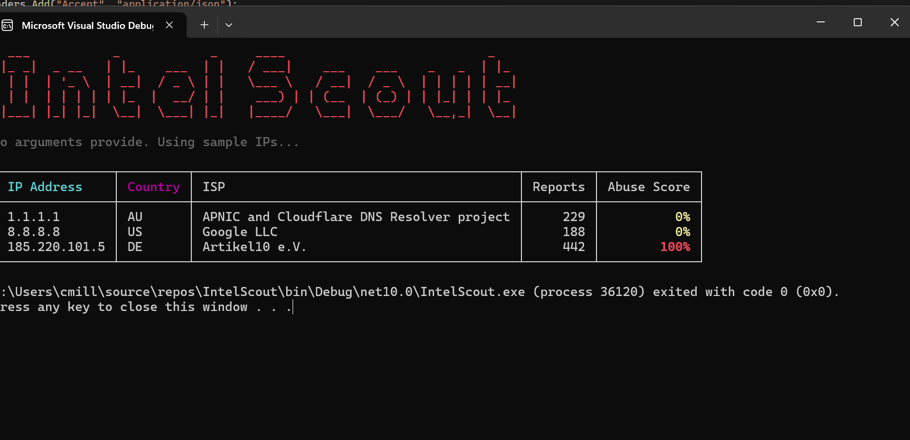
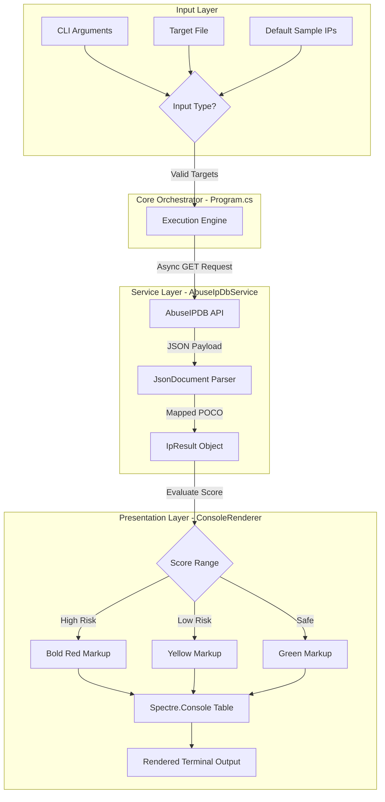

**IntelScout** is a lightweight C# threat intelligence CLI engine targeting **.NET 10**. Designed for rapid incident response and network telemetry, it interfaces directly with the AbuseIPDB v2 REST API to evaluate IP indicators of compromise in real time.

It supports both terminal queries and batch text-file target lists, using `Spectre.Console` to render execution spinners and styled console reporting.



---

## Technical Highlights

- **Asynchronous Execution & Socket Management:** Utilizes a single static `HttpClient` pattern to prevent socket exhaustion during high-volume batch processing.
- **Dual Target Parsing:** Flexibly accepts inline command-line arguments or bulk target files using **LINQ** pipelines for inline whitespace scrubbing and null-entry filtering.
- **Fault-Tolerant API Engine:** Implements structured exception handling with fallback state rendering (`Connection Failed / ERR`) so individual query timeouts don't crash long-running batch checks.
- **Dynamic Terminal Telemetry:** Features live execution spinners, custom ASCII FIGlet titles, and automatic risk-based color formatting (Green: Low Risk, Yellow: Moderate Risk, Red: High Abuse Score).

---

## System Architecture & Data Flow


## Verification & Testing
To execute the built-in test suite and verify assembly compilation under .NET 10:
- An **AbuseIPDB Account**: If you don't have one, register for a free account at [AbuseIPDB](https://www.abuseipdb.com/) to generate your API key.

```bash
dotnet build --configuration Release
dotnet run -- 1.1.1.1 8.8.8.8
